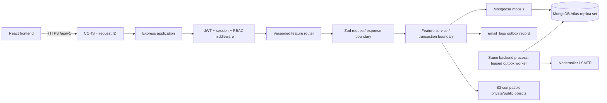

# Backend Architecture

## Decision

**CONFIRMED_BY_OWNER:** Node.js LTS, Express, strict TypeScript, MongoDB/Mongoose, Zod, JWT, Argon2id, OpenAPI, Vitest/Supertest, Nodemailer/SMTP, and S3-compatible storage where media requires it. Use a **modular monolith** organized by feature. One API deployment and a Mongo-backed email worker are sufficient for this scope; do not add Redis, a message broker, microservices, NestJS, SQL, or a payment gateway.

## Request and background-work flow



The route layer parses/normalizes HTTP input, the service layer owns business rules and transactions, and model/repository code performs persistence. Do not put authorization or pricing decisions in React or Mongoose hooks. Keep external side effects (SMTP/object storage) outside MongoDB transactions; persist an outbox event in the same transaction as the durable state change and deliver after commit.

## Suggested backend layout

```text
backend/src/
  app.ts                 # Express construction, no listener side effects
  server.ts              # config, DB connection, worker lifecycle, listen/shutdown
  config/                # parsed Zod environment; no committed secrets
  http/                  # request id, auth/session, RBAC, errors, pagination
  modules/
    auth/ catalog/ media/ learning/ quiz/ progress/
    enrollment/ commerce/ admin/ notifications/
  db/                    # Mongoose connection, model registration, transactions
  shared/                # IDs, Decimal128 money helpers, clock, logger
```

Each feature owns route, Zod DTOs, service, model/schema, repository/query helpers, and tests. Keep cross-feature writes behind a service transaction (for example `commerce.approveOrder` calls enrollment and audit/outbox operations within one session). Avoid a generic repository framework that obscures Mongo query/index behavior.

## Runtime contracts

- Base route `/api/v1`; JSON UTF-8; UTC ISO-8601 timestamps.
- Mongo `_id` ObjectIds serialize as 24-character `id` strings; never expose raw Mongoose documents.
- Money uses Decimal128 in Mongo, decimal strings in API DTOs; calculate with decimal-safe arithmetic, never `number` multiplication.
- Zod validates params/query/body and environment; unknown write fields reject with `VALIDATION_ERROR`.
- Mongoose schemas use strict field allowlists, explicit refs, and `timestamps` only where the contract defines them. No automatic cascading deletion.
- Readiness distinguishes process health from DB/worker health; graceful shutdown stops accepting requests, drains worker, then closes Mongo.
- Request logging redacts passwords, reset/refresh tokens, authorization headers, bank account configuration, and protected media URLs.

## MongoDB and transactions

Order approval, enrollment adjustment, coupon reservation/redemption, login session replacement, and durable outbox scheduling require atomic multi-document work. Target a MongoDB replica set capable of transactions (Atlas supports replica-set deployments, but the selected DBX inventory is not an app setup verification). The service must fail closed with a clear unavailable error if transaction support is absent; it must not silently perform a partial approval. Read preference/concern and transaction retry policy are deployment settings to settle in BE-01.

## Storage and email

Use S3-compatible private storage for protected course assets and public/CDN delivery only for specifically public assets. Persist provider and storage key, never a permanent signed URL. Issue short-lived access URLs after authorization, or proxy media when the chosen provider cannot enforce the required restrictions. SMTP credentials and bucket credentials come from deployment configuration, not the repository. `email_logs` acts as a minimal durable outbox with lease/retry fields; a bounded worker polls it with indexed claims. No Redis is needed.

## Observability and test boundary

Emit request ID, route, status, duration, and safe actor/resource identifiers. Keep audit log separate from operational logs. Tests should be layered: Zod/service unit tests, Supertest API contracts, transaction integration tests on replica-set Mongo test instance, then frontend adapter contract tests. BE-00 did not execute those tests.
