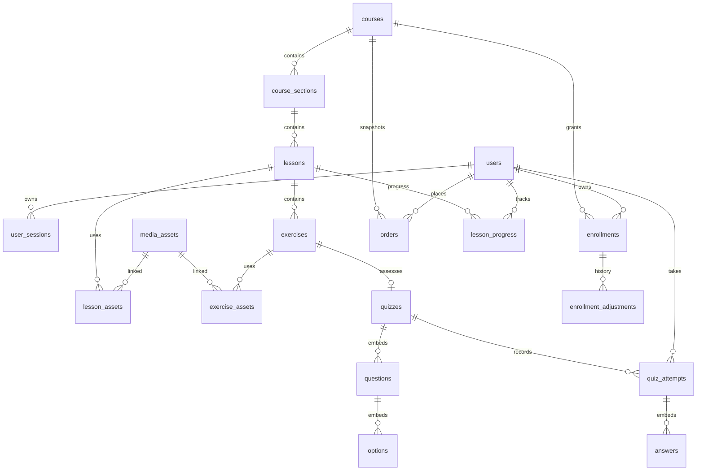

# MongoDB Collection Design

## Physical collection map

Use MongoDB collection names in snake_case for continuity with the PDF. References between independently managed or queried entities are ObjectIds. A logical PDF table may map into an embedded document instead of a collection.

| Domain | PDF name | Physical mapping | Storage decision / notes |
|---|---|---|---|
| Auth | `users` | `users` | Independent identity; private hashes never leave service |
| Auth | `user_sessions` | `user_sessions` | Independent revocable session; refresh hash only |
| Auth | `login_events` | `login_events` | PDF names only; proposed fields, privacy retention open |
| Auth | `password_reset_tokens` | `password_reset_tokens` | PDF names only; store one-way token hash |
| Catalog | `courses` | `courses` | Independent product/publication aggregate; add `price` and proposed optional `introVideoAssetId` |
| Catalog | `course_sections` | `course_sections` | Separate CMS/order/publication lifecycle |
| Catalog | `lessons` | `lessons` | Separate CMS/progress reference |
| Learning | `exercises` | `exercises` | Separate progress and asset ownership |
| Learning | `media_assets` | `media_assets` | Object metadata independent of lesson associations |
| Learning | `lesson_assets` | `lesson_assets` | Association + role/title/order; unique association index |
| Learning | `exercise_assets` | `exercise_assets` | Association + answer/prompt asset role; exact access check |
| Quiz | `quizzes` | `quizzes` | Own one bounded quiz per exercise; embeds `questions[]` and nested `options[]` |
| Quiz | `quiz_questions` | `quizzes.questions[]` | Logical PDF row retained as embedded object; stable embedded `_id` |
| Quiz | `quiz_options` | `quizzes.questions[].options[]` | Logical PDF row retained as embedded option; `isCorrect` internal only |
| Quiz | `quiz_attempts` | `quiz_attempts` | Independent attempt/result/audit entity |
| Quiz | `quiz_attempt_answers` | `quiz_attempts.answers[]` | Embedded immutable selected/correct/points snapshot; not read independently |
| Progress | `lesson_progress` | `lesson_progress` | One unique per user/lesson |
| Progress | `exercise_progress` | `exercise_progress` | One unique per user/exercise; quiz/manual source |
| Progress | `lesson_notes` | `lesson_notes` | One unique per user/lesson |
| Enrollment | `enrollments` | `enrollments` | One current entitlement record per user/course |
| Enrollment | `enrollment_adjustments` | `enrollment_adjustments` | Append-only renewal/grant/revoke/restore history |
| Enrollment | `renewal_plans` | `renewal_plans` | Independent Admin-managed plan; price is not in PDF |
| Commerce | `orders` | `orders` | Sole payment/order aggregate for manual transfer; no gateway transaction table |
| Commerce | `coupons` | `coupons` | Admin-managed rule and optional atomic redemption counter extension |
| Commerce | `coupon_redemptions` | `coupon_redemptions` | Immutable applied discount record; unique order relation |
| Platform | `email_logs` | `email_logs` | Delivery log plus proposed leased outbox fields |
| Platform | `site_settings` | `site_settings` | Singleton document; optional proposed `payment` subdocument |
| Platform | `audit_logs` | `audit_logs` | Append-only actor/action/object snapshots with sensitive-data redaction |
| Commerce | `payment_transactions` | **omitted** | Explicit owner prohibition; no replacement collection or webhook |

This produces **25 physical collections**. The PDF names 29 structures: 27 with field definitions plus the two auth-support names without fields. Of the 27 defined tables, omit `payment_transactions` and embed the three tightly coupled quiz child tables, leaving 23 collections; add the two auth-support collections with recommended fields, for 25 total.

## Reference and embed boundary

`questions/options` are bounded and fetched with their quiz for editing/attempt start. `answers` are bounded to one attempt and must be retained with the grading snapshot. All other listed relations are referenced because they have independent status/order/retention/access or may be listed across many parents. Store objectives/requirements as arrays on courses, and public payment configuration as an optional embedded object on the singleton site settings.

## Cross-cutting rules

- Use ObjectId references; validate referenced parent and same-course ancestry in services, not just ID existence.
- Use UTC `Date`; only the frontend formats local display time.
- Store money as `Decimal128`; serialize as decimal integer strings for VND. Never serialize the raw BSON decimal object.
- Soft-delete only `courses`, `course_sections`, `lessons`, and `exercises`, where `deletedAt` exists in the PDF. Public queries filter active/non-deleted parents and published descendants.
- Do not cascade-delete progress, orders, enrollments, audit logs, or media. Deletion/archival policy for dependent assets is an Admin workflow.
- Schema field-by-field contract, source labels, validation, private projections, and index definitions are in [05](05-MONGOOSE-SCHEMA-SPEC.md), [06](06-RELATIONSHIPS-AND-INDEXES.md), and machine-readable [schema-catalog.json](schema-catalog.json).
