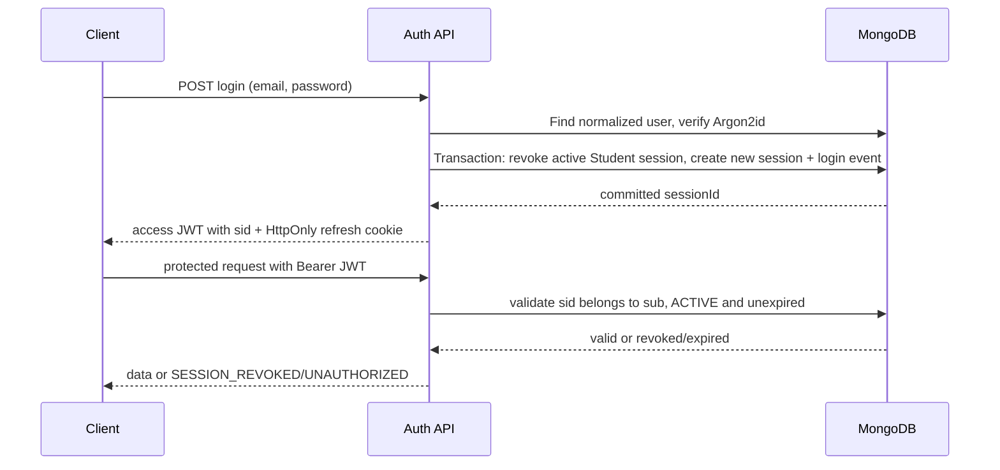

# Authentication and Security Design

## Credentials and tokens

- Hash passwords with Argon2id using maintained library defaults that meet current OWASP guidance; store encoded hash only in `users.passwordHash`. Parameters are config/versioned, never logged. Rehash on successful login if parameters are upgraded.
- Issue short-lived signed access JWTs (recommend 10–15 minutes; **technical recommendation**). Claims: `sub` user ObjectId string, `sid` session ObjectId string, `role`, `iat`, `exp`, `iss`, `aud`, and random `jti`. No email, phone, or profile data is needed in token. Validate fixed algorithm allowlist, issuer, audience, expiry, and clock skew.
- Generate high-entropy opaque refresh token; persist only a cryptographic hash in `user_sessions.refreshTokenHash`. Deliver through `Secure; HttpOnly; SameSite=Lax; Path=/api/v1/auth` cookie (cookie lifetime must not exceed session expiry). Access token is returned to the frontend and held in memory; do not place tokens in localStorage.
- Exact access/refresh lifetimes and issuer/audience are deployment decisions. Refresh cookie domain should be host-only unless the deployed frontend/API domain layout requires otherwise.

## Login and active-session lifecycle



Student login revokes the prior active Student session and creates a new one in one transaction. Role and active-user status are rechecked. Protected requests verify the JWT and load/check the session (`sid`, `sub`, `ACTIVE`, `expiresAt > now`); an otherwise-valid old token receives `SESSION_REVOKED`. The PDF does not decide Admin session cardinality; a proposed `roleAtIssue` session field supports a Student-only uniqueness rule. Do not silently apply the Student policy to Admin.

Refresh verifies cookie token hash, active session, user status, expiry, origin/CSRF guard; rotates the opaque token and updates the hash atomically. Reuse of a previously rotated token should revoke that session and create an audit event (**REC; document exact detection field before implementation**). Logout revokes current session and clears cookie. Revoke-session endpoint may target only sessions owned by caller; server revokes current token immediately if current session is targeted.

## Registration and reset

- Register accepts only Student-safe fields; role is always `STUDENT`. Unique normalized email conflict is `409 CONFLICT`.
- Forgot-password always returns a generic success for known/unknown addresses. Generate one-time random token, store only its hash + expiry/consumption, and enqueue email after commit.
- Reset verifies hash, expiry, and unused state; transaction marks token consumed and replaces password hash. Revoke all active user sessions after password change/reset; this is a **security recommendation** to confirm.
- Change-password requires current password, then hashes new password. Email verification policy is unspecified in the PDF; do not gate registration on an invented rule.

## Authorization, validation, and abuse limits

1. Authentication middleware validates JWT and active session.
2. Role middleware requires `STUDENT` or `ADMIN`; never trust role from request body or frontend.
3. Resource service checks ownership/entitlement and full parent chain. Media service additionally checks exact join record. Admin operations check role and write audit entries.
4. Zod parses route params, query, body, and environment. Reject unknown input keys on writes; validate length/ranges/enums before model operations.
5. Apply rate limits to login, register, forgot/reset password, refresh, coupon validation, and media URL issuance. Rate-limit storage can be a bounded Mongo mechanism or deployment edge feature; do not introduce Redis by default. Thresholds are operational configuration, not invented policy.
6. Restrict CORS to exact configured frontend origins. Allow credentials only for refresh-cookie routes; do not use `*` with credentials.

Cookie-based refresh requires CSRF protection: `SameSite=Lax`, exact `Origin` validation, and a CSRF token/custom header for state-changing cookie-authenticated operations. Bearer access endpoints are less exposed to ambient-cookie CSRF; refresh/logout still enforce origin/CSRF checks. Deploy only over HTTPS.

## Error envelope

Proposed consistent shape, compatible with current mock's `success:false` envelope while enriching `details`:

```json
{
  "success": false,
  "error": {
    "code": "VALIDATION_ERROR",
    "message": "Request validation failed.",
    "details": [{ "path": "email", "code": "invalid_format" }]
  },
  "requestId": "server-generated-id"
}
```

`VALIDATION_ERROR` (400/422), `UNAUTHORIZED` (401), `FORBIDDEN` (403), `NOT_FOUND` (404), `CONFLICT` (409), `SESSION_REVOKED` (401), `RATE_LIMITED` (429), and `INTERNAL_ERROR` (500) are **PROPOSED** standardized codes, except `SESSION_REVOKED` is also used in frontend demo error handling. Never return stack traces, password hashes, token hashes, `isCorrect`, storage keys, bank configuration to non-admin callers, or provider errors.

## Security data and audit

Do not log authorization/cookie headers, passwords, reset tokens, raw refresh tokens, full signed URLs, or submitted banking details. Treat IP, user agent, phone, email, and device identifiers as personal data; define retention, access, and deletion policies before production. Audit Admin status, catalog, order approval, enrollment, coupon, and settings changes with actor/resource IDs and redacted before/after projections.
