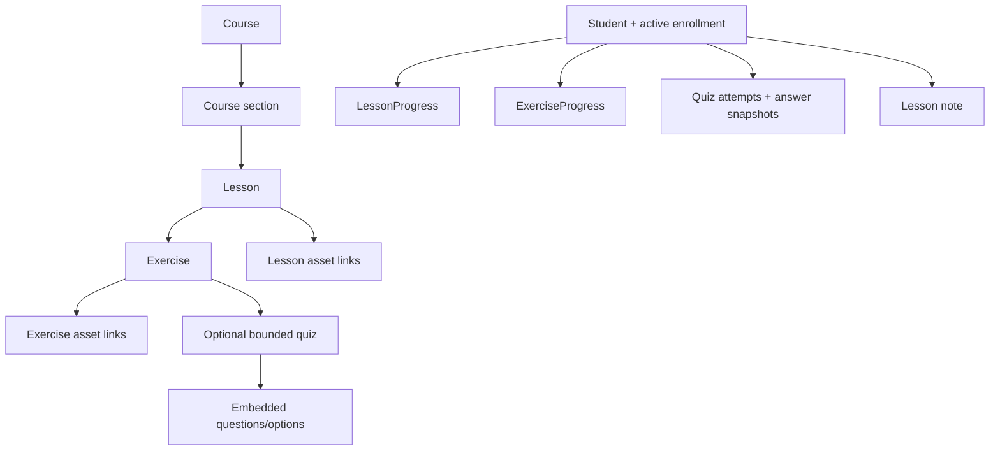

# Learning, Quiz, Media, and Progress Design

## Course tree

## Access calculation

For each learning/asset request, resolve the parent course and verify an authenticated `STUDENT`, active session, `enrollments.status=ACTIVE`, and `expiresAt > nowUtc`. Check the full parent chain and that the requested section/lesson/exercise/asset belongs to that course. The caller's URL path/resource ID must match the association row. Do not reveal whether another student's resource exists; choose a consistent 404/403 policy and document it in API implementation.

`ANSWER_PDF` and `SOLUTION_VIDEO` use the same enrollment + exact association guard as question assets. Completion state is deliberately not part of this access decision. No learner-submitted file endpoint exists.

## Lesson completion and progress

On lesson read, update/initialize `IN_PROGRESS` and `lastAccessedAt` idempotently. `POST complete lesson` recomputes the set of published required exercises and their server-recorded `COMPLETED` progress. If any required item remains, respond `409 COMPLETION_REQUIREMENTS_UNMET` with safe outstanding IDs or a non-sensitive count; never trust client percentages. If eligible, upsert lesson completion timestamps once.

Course progress is a derived service result: numerator = completed lessons with `countsTowardProgress=true`; denominator = eligible, published, nondeleted lessons under the active course. Return denominator and numerator plus calculated percent; define zero denominator as 0% (REC). UI cannot write aggregate progress. Recompute on read initially; only introduce cached rollups after measured need.

Manual exercise completion records `completionSource=MANUAL`. Quiz completion records source `QUIZ` after successful server grading and the PDF-defined passing/accepted rule; whether every submitted quiz or only score-threshold success completes the exercise is an open decision. Upserts are idempotent.

## Quiz lifecycle

1. `POST .../quiz-attempts` verifies active enrollment and published quiz/exercise, copies current question prompt/options/points into an attempt snapshot, excluding `isCorrect` from response.
2. Learner selects one option per question; save only question/option IDs, validating each belongs to the frozen attempt. Do not accept score/correctness from client.
3. `POST submit` is atomic/idempotent. Server grades against frozen key, writes result and answer snapshots, `submittedAt`, then progress if the completion rule allows it.
4. `GET result` checks attempt owner and submitted state; only then returns allowed review information. `showCorrectAnswers` is a quiz setting but owner rule means it cannot leak before submit. Post-submit review permission semantics remain to confirm (respect setting if it means “never show answers”).
5. Retry creates a new attempt snapshot and leaves earlier result unchanged. No attempt limit is introduced because none was confirmed.

Option ID/label safety: for an in-progress attempt, response options contain identifiers and labels only; `isCorrect`, correct option, explanation, and correctness-derived fields are omitted. Attempt snapshot prevents later Admin quiz edits changing grade/result.

## Media

Store provider/object key, media type, MIME, byte length, and duration metadata only. Admin upload flow: request bounded upload authorization → upload to chosen provider → finalize metadata/ownership → create association. Student access returns short-lived URL and expiry, or a server proxy, after all guards; no storage key crosses API boundary. Intro/public media must be explicitly marked/associated as public; arbitrary paid lesson assets never become public by URL guess. Storage provider, CORS, size limits, and URL TTL are deployment decisions.

## Notes

One private note per learner/lesson, upsert by `(userId,lessonId)`. `GET` returns empty content when absent; `PUT` is idempotent and updates `updatedAt`. Bound text length once content policy is agreed. Admin access, if ever needed for support, must be separately authorized and audited.
