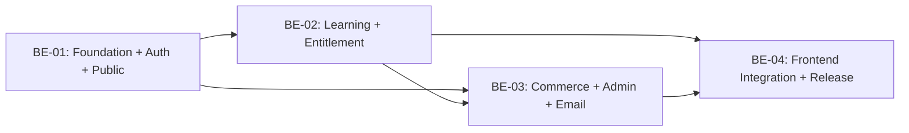

# Backend Implementation Roadmap

## BE-01 — Express foundation, auth, and public courses

**Dependencies:** confirm API/frontend origins, deployment runtime, access/refresh TTL, CSRF/origin rules, Admin bootstrap procedure, Mongo replica-set URI secret injection, and whether auth email verification is required. No database schema setup in BE-00.

**Work order:**
1. Backend package, strict TypeScript, config Zod schema, Express app/server lifecycle, request ID/logger/error envelope.
2. Mongo connection and transaction capability check; Mongoose base options and index migration policy.
3. Shared Zod DTO/errors/pagination; password Argon2id utility.
4. `users`, `user_sessions`, proposed reset/login event schemas and indexes; register/login/refresh/logout/forgot/reset/me, JWT/session/RBAC middleware.
5. Public settings/course list/detail/outline; published/nondeleted projections and Decimal128 mapper.
6. Supertest contracts and replica-set auth/index integration tests; document origin, secret, cookie, and bootstrap setup.

**Acceptance:** no token/hash leaks; role cannot be self-assigned; one Student active session; login revokes old session; protected request checks `sid`; refresh rotates hash and rejects reuse; public APIs hide drafts; prices are exact decimal strings; OpenAPI responses match implementation.

## BE-02 — Learning core

**Dependencies:** BE-01 identity/session and catalog; approve lesson content payload, quiz enum/completion/review rules, storage provider/limits/URL TTL, and answer visibility (already confirmed to not require completion).

**Work order:**
1. Course hierarchy, exercises, media metadata/associations, Admin publication constraints.
2. Enrollment entitlement middleware and private/public media authorization.
3. Quiz aggregate with embedded question/options; attempt snapshots, answer DTO projection, grading, retry.
4. Exercise/lesson progress and server-derived course progress; notes.
5. Admin content/media APIs, then Student learning APIs; transaction/ownership tests.

**Acceptance:** hidden content does not leak; asset association is exact; enrolled learner can access answer assets before completion; unentitled user cannot; correct answer fields absent pre-submit; server grade/snapshot stable after quiz edit; retry creates distinct attempt; lesson completion gated by required exercises; progress cannot be client-forged; progress survives renewal.

## BE-03 — Commerce, Admin operations, email, and CMS completion

**Dependencies:** approve renewal plan price, month-end rule, discount/coupon semantics, bank details source, SMTP provider, transfer expiry/coupon reservation policy, Admin manual enrollment policy.

**Work order:**
1. Decimal money helpers and order/course/renewal snapshots; coupon validation/atomic usage.
2. Static payment instructions configuration; order create/list/detail; transfer-submitted idempotency.
3. Admin pending-order query and approval transaction with enrollment adjustment, audit and outbox.
4. Mongo-backed email worker, retry/lease/dedupe, student/admin notices, seven-day reminder.
5. Renewal, enrollment/coupon/site-setting Admin APIs; publication and audit coverage.

**Acceptance:** pending order cannot access content; transfer confirmation never grants access; only Admin can approve; concurrent approval has one effect; order/adjustment/enrollment/audit/outbox commit together; notification failure cannot revert paid order; renewals retain progress; coupons cannot overrun limits; no payment gateway/webhook/payment transaction collection.

## BE-04 — Frontend integration and release

**Dependencies:** BE-01 through BE-03 contracts and selected deployment.

**Work order:** typed HTTP adapter and auth refresh behavior; replace fixture repositories; refactor fixed preview and simulated payment; wire QR, pending review, enrollment approval, and admin flows; contract tests, cross-origin cookie test, accessibility/runtime tests, security review, deployment preparation.

**Acceptance:** every repository operation uses real API, no `.test` persona or simulated paid state in production, stale student cache clears on session end, DTO money exactly matches order snapshot, API and frontend contract tests pass, protected content and admin approval are verified end-to-end.

## Critical dependency graph

Do not begin BE-01 by creating collections directly in the supplied Atlas cluster. First establish a controlled development database/configuration and explicit index/migration process.
