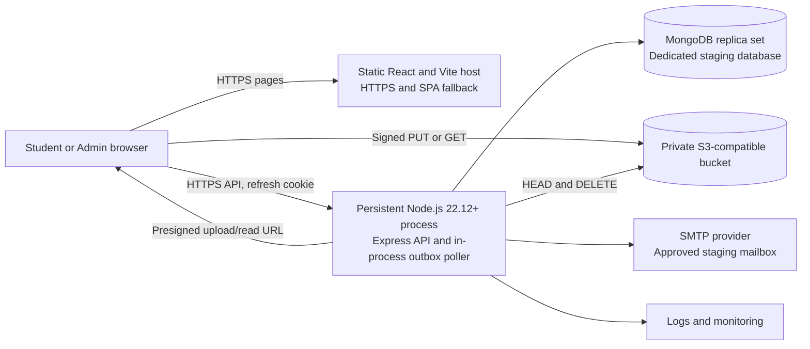

# Staging Architecture

**Recommendation: PREPARED_ONLY.** Use the simplest architecture that matches the current code: a static Vite frontend plus one persistent Node.js/Express process that also runs the MongoDB-backed email outbox poller.

## Runtime choice

- **Design A — Express plus worker in one persistent process: recommended initially.** `src/server.ts` connects MongoDB, starts Express, then starts `EmailOutboxWorker`. One deployable backend artifact and one persistent service are sufficient for a cost-conscious first staging environment.
- **Design B — API and separate persistent worker: later option.** Use only if separate scaling, deploy cadence, or failure isolation becomes a demonstrated need. The worker must share the durable MongoDB outbox, atomic lease logic, and dedupe keys; it needs its own monitored persistent process.
- A short-lived request-only serverless process is not an adequate worker host for the current polling design. Do not introduce Redis or another broker without a measured requirement.

## Provider-neutral requirements

- Frontend host serves Vite assets over HTTPS and falls back to `index.html` for React Router paths. Configure `VITE_API_BASE_URL` at build time. Hashed assets may use immutable caching; the HTML entry should be revalidated.
- Backend host supports persistent Node.js `>=22.12.0`, outbound MongoDB/SMTP/S3 access, environment secrets, graceful SIGTERM/SIGINT, and a readiness probe to `/ready`.
- MongoDB must be a replica set because transactions are used. Use a separate staging database, staging-only credentials, restricted network access, and verified backup/restore.
- S3-compatible bucket remains private. Browser upload/read uses signed URLs; CORS must match the exact staging origin and signed request headers.
- Terminate HTTPS at an owner-approved proxy/load balancer. Set exact API origin allowlists and cookie policy. Decide trusted proxy hops before changing Express proxy behavior.
- Collect redacted structured logs and request IDs; alert ownership is still an owner decision.

No provider, plan, region, paid service, or infrastructure was selected or provisioned.
