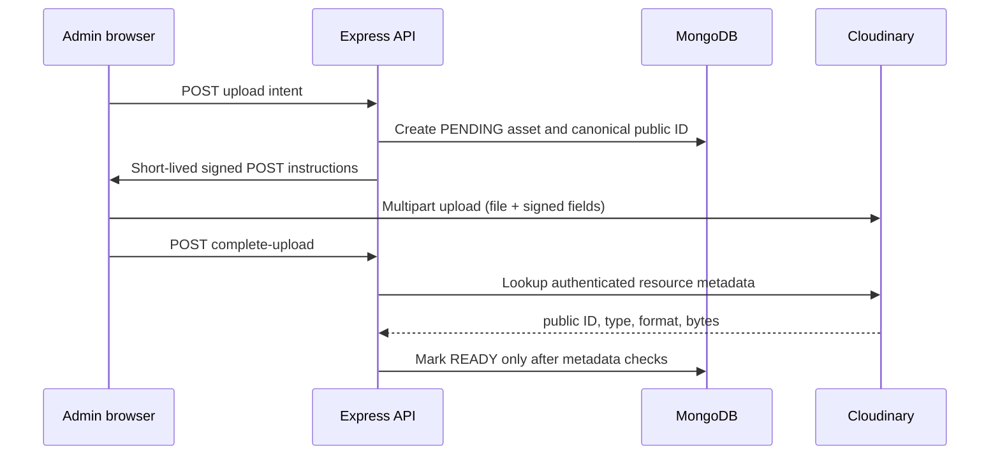

# Media architecture

## Runtime provider selection

`MEDIA_PROVIDER` selects one active upload provider. `createMediaStorageAdapter` builds an adapter router for configured providers. New uploads use the active adapter. Reads, verification, and deletes resolve the adapter from the media row's persisted `provider`, so existing S3-compatible records remain addressable while Cloudinary is active.

The Mongo `MediaAsset` ObjectId and its canonical provider storage key identify the application asset. The Cloudinary `asset_id` is provider metadata and is not used as the application's identity. Credentials and storage keys remain excluded from ordinary Mongoose selection.

## Upload flow

Cloudinary PDFs use the `image` resource type; audio uses `video`. Both are stored with `authenticated` delivery. Signed download URLs are created on demand and carry a real expiration. The API marks preview responses `Cache-Control: private, no-store`.

## Existing records

S3 rows keep their existing keys and are read/deleted through S3. Cloudinary rows keep their canonical public IDs and use the Cloudinary adapter. No provider registry or automatic fallback is introduced. If the persisted provider is not configured, the API returns an unavailable error.

## Migration shape

Migration runs as an operator CLI, outside the app request path. It reads source and target Cloudinary accounts per call, never changes process-wide Cloudinary credentials, never trusts manifest URLs, and never deletes source assets. Cutover changes the single active environment account only after verified copy and operator review.

References: [Cloudinary PDF delivery](https://cloudinary.com/documentation/ts_how_to_upload_manage_and_deliver_pdf_files), [authenticated media access](https://cloudinary.com/documentation/control_access_to_media).
