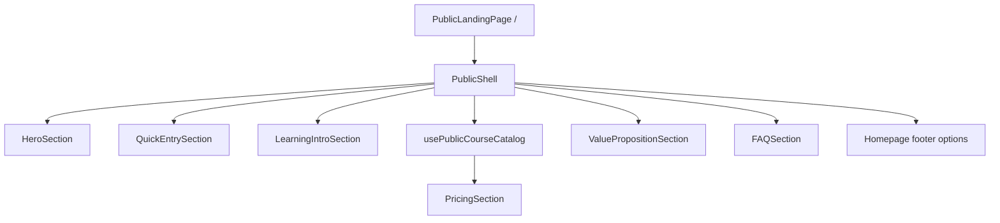

# Kiến trúc section trang chủ

## Luồng composition

## Trách nhiệm

- `PublicLandingPage` quyết định thứ tự section, đọc trạng thái catalog và cung cấp tùy chọn footer/header riêng của homepage.
- Các component trong `features/homepage/sections/` sở hữu bố cục từng section; chúng không sửa repository hay luồng nghiệp vụ.
- `content/homepage-content.ts` chứa copy tĩnh và các liên kết footer.
- `PricingSection` nhận các `CourseSummaryModel`, hiển thị loading/error/empty và trình bày giá qua `formatVnd` khi dữ liệu có giá trị.
- `homepage.css` chỉ chứa hình học riêng của hero; spacing, màu, typography và responsive layout dùng token/Tailwind utilities hiện có.
- `PublicShell` nhận các props tùy chọn cho homepage. Giá trị mặc định giữ hành vi của các route công khai khác.

Không tạo `FinalCTASection` riêng; lời mời học thử nằm trong hero và FAQ để tránh lặp thêm một section cuối trang.
