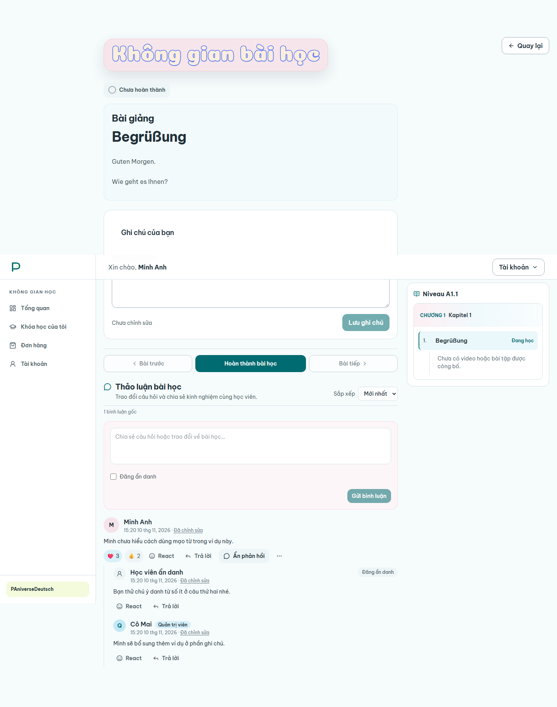
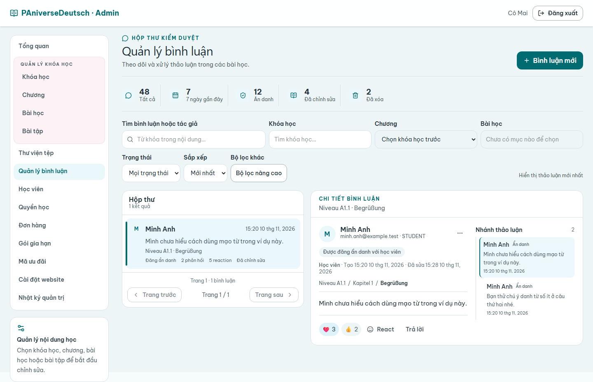
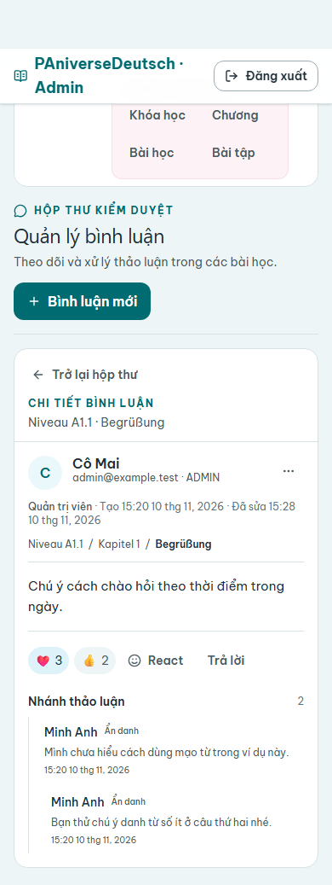

# Visual comparison

The redesign changes the information structure in both roles:

| Before                                                                    | UI-11                                                                                                 |
| ------------------------------------------------------------------------- | ----------------------------------------------------------------------------------------------------- |
| Student replies read as separate card-like items.                         | Compact flat thread list with a subtle connector and clear root/reply actions.                        |
| Lesson navigation followed the discussion.                                | Previous, complete, and next actions appear before discussion.                                        |
| Admin comments used a dense, wide table for locating and reading context. | Paginated inbox list with a focused master-detail view and filters above it.                          |
| The Admin route inherited the decorative page heading.                    | The comments route uses a plain, readable heading; other Admin routes retain their existing headings. |
| Mobile detail shared the long filter surface with the list view.          | Mobile switches between inbox list and detail, hiding list filters while detail is open.              |

The prior state did not have a saved UI-11 baseline screenshot, so this is a qualitative comparison of layout and interaction, not a pixel-difference claim. The new screenshots show the rendered app state using synthetic API fixtures.

## New state

The Admin mobile screenshot includes the application's existing global navigation, which remains visible during the detail view.
